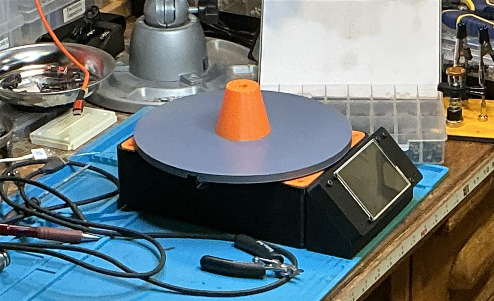
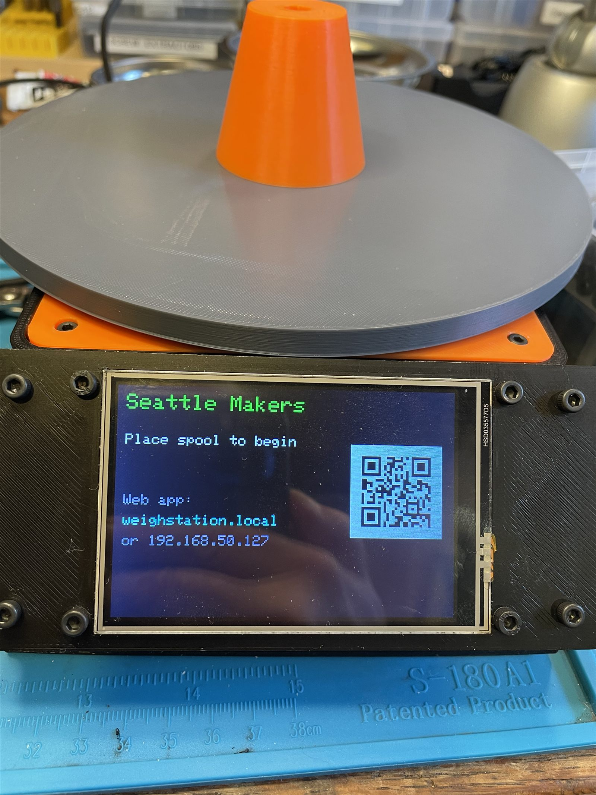
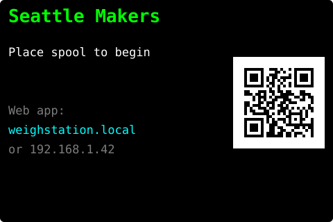
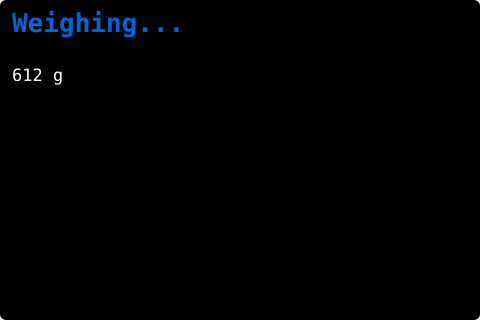
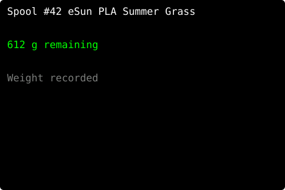
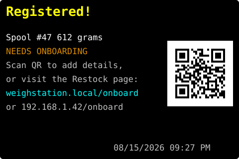
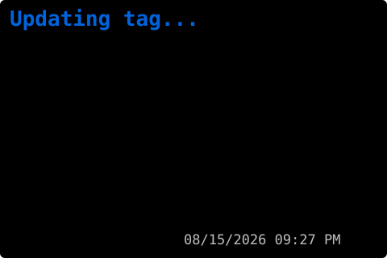
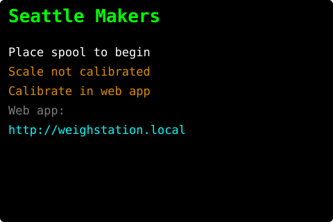
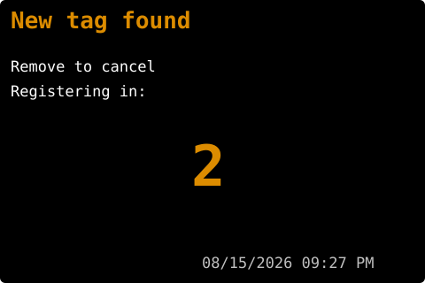
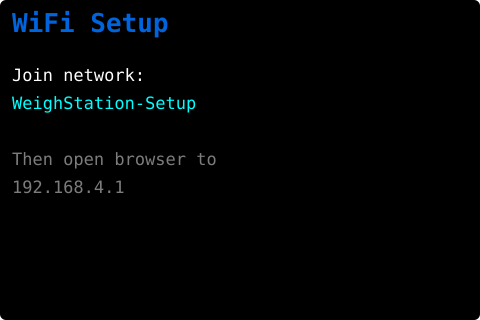

# Weigh Station — User Manual



The Weigh Station tracks the 3D-printing lab's filament. Place a spool on the
scale: it reads the spool's NFC tag, weighs it, and records the remaining
filament on the device. The web app at `http://weighstation.local/` shows
inventory and history, onboards new spools, flags reorders, and takes
backups. There is no external server.

**Quick references** for posting at the station:
[Weighing](quickref-weighing.md) ·
[Onboarding](quickref-onboarding.md) ·
[Inventorying](quickref-inventorying.md) ·
[Tag Erase](quickref-tag-erase.md).
**Printable PDF, one page each:** [weigh-station-quickrefs.pdf](weigh-station-quickrefs.pdf).

---

## For Members: Weighing a Spool

1. **Place the spool on the scale.** No button needed.
2. **Wait** until the display shows the spool number, material and remaining weight.
3. **Remove the spool.** The reading is saved.

**Weigh every spool when you return it.**

### What the display shows



| Display | Meaning |
|---|---|
|  | **Ready.** Place a spool. |
|  | **Weighing.** Don't lift yet. |
|  | **Done.** Remove the spool. |
|  | **New spool registered.** Enter its details (see *New Spools*). |
|  | **Updating tag.** Don't lift yet. |
|  | **Scale not calibrated.** Tell an admin. |
| Red **ERASE MODE** on the idle screen | **Erase mode is on.** Any tag placed is erased. |

**Opening the web app from your phone:** scan the QR code on the idle screen.
Or type `weighstation.local`; if that doesn't load, type the numeric address
shown under it.

### Status light

| Color | Meaning |
|---|---|
| Dim green | Ready |
| Blue | Working (WiFi setup, weighing, writing the tag) |
| Green | Spool weighed and saved |
| Yellow | Spool registered; needs details entered |
| Amber, blinking faster | New-tag countdown; remove the spool to cancel |
| Magenta | Erase mode is on |
| Red | Tag read error; reposition the spool |

---

## For Members: New Spools

### Applying a tag

Use an **OpenPrintTag MK1** sticker (from [Prusa](https://www.prusa3d.com/);
reordering is in `docs/build-guide.md`). Stick it on the spool's flat hub
face, centered so it sits over the reader. Press firmly for 5 seconds.

**Don't reuse tags.** Peeling one off can crack its antenna. Use a new tag for
every new spool.

### Registering it

1. **Place the spool on the scale.** The display counts down from 2 ("New tag
   found / Remove to cancel").

   

2. **Remove it** to cancel, or **leave it** to register.
3. The display shows **Registered!**, the spool number and **NEEDS ONBOARDING**.
   **Scan the QR code**, or open `weighstation.local/onboard`. Keep the spool
   on the scale.

   

### Onboarding it (web app)

On the **Restock** page, say what the spool is. Try these in order:

- **Scan the box's barcode.** It can be scanned before or after the spool is
  placed (a scan with no spool on the scale is held for one minute). A
  barcode the station knows picks the Stock List item for you. An unknown one
  says so; pick the item, and the barcode is learned for next time.
- **"Which stock item is this?"** Type to search the Stock List and click the
  item. This is the best choice: Reorder counts the spool against that exact
  item. Greyed items aren't linked to a product yet (an admin fixes that on
  the Repair page).
- **"This spool is…"** for a product on file that isn't a stock item. Type
  in the box above it to filter the list.
- **New product?** Use the **catalog search**. The vendor, material type and
  material fields show the last product picked. Same product? Leave them.
  Different? Click a field to see the full list, or type to narrow it.
- **Not in the catalog?** Open **Or enter manually** and pick the vendor,
  material and colour. Use **+ Add new** for anything missing.

Then:

1. **Set the tare** (the empty spool's weight; required). Either:
   - pick a **spool profile**, or
   - type the tare, or
   - put an empty spool of the same type on the scale and press **Capture tare**.

   With manual entry, a spool profile is required (it also sets the full weight).
2. **Cost** (optional): what the reel cost. Leave it blank if you don't know.
   Blank keeps a price already recorded; `0` clears it.
3. Check the line above **Save**. **"Barcode … will be recorded for …"** is
   right only if the scan was this box; otherwise press **clear**.
4. Press **Save & write tag.** The page asks first if the barcode doesn't
   match the product (wrong pick, or a scan of a different box), or if the
   product was picked by hand after the scan.

**Next spool:** place it. The page moves to it.

### Changing a spool that's already onboarded

Open **Restock** with the spool on the scale. The page names the spool. Click
**Change this spool's details**:

- **To add a price:** type it and save. Nothing else changes.
- **To attach it to a different product:** pick that product and save.
- **To give it a new product:** choose **a new product**. The page asks you to
  confirm.

Saving rewrites the tag.

### Spools that arrive with a tag

Spools with a tag already on them (genuine Prusament, or tagged elsewhere)
need no onboarding. **Just place them.** The station reads the tag's details
and adds the spool. If the tag has no tare, it gets 170 g; correct it on the
product's page if that's wrong.

**Don't rewrite station tags with the Prusa app** or any other app. The
station treats the rewritten tag as a new spool and retires the old one.

---

## For Administrators: Initial Setup

Full build and flash steps: [`DEVELOPMENT.md`](../DEVELOPMENT.md).

### 1. Hardware assembly

Wire the parts per [`hardware/netlist.md`](../hardware/netlist.md). The
NAU7802 connects by Qwiic cable; the PN5180 NFC module and the ILI9488 display
share the SPI bus.

### 2. Flash the firmware

```bash
pio run --target upload
```

### 3. First-time WiFi setup

On first boot the display shows the WiFi setup screen:



1. On a phone or laptop, join the `WeighStation-Setup` network.
2. The setup page opens (or browse to `192.168.4.1`).
3. Pick the lab's network and enter its password.
4. Submit. The idle screen shows `http://weighstation.local/`.

The station only joins **2.4 GHz** networks with a **password** (not
enterprise/802.1X logins). If it can't join, it runs its own `WeighStation`
network instead; the idle screen shows what to join.

### 4. Calibrate the scale

The idle screen shows **"Scale not calibrated"** until this is done.


1. Open **Administration → Calibrate**.
2. **Clear the scale**, then press **Zero (tare)**.
3. **Place a known weight**, type its mass in grams, then press **Set calibration**.

The banner clears. (Over USB serial at 115200 baud, `ZERO` and `CAL <grams>`
do the same.)

---

## For Administrators: Ongoing Maintenance

### The web app

| Page | What it's for |
|---|---|
| **Inventory** | Remaining filament by material. Click a row for its spools; click a spool for its weigh history (CSV), its cost, and its product. Audits start here. |
| **Reorder** | Stock List items at or below their threshold. Download, copy or e-mail the list. |
| **Restock** | Enter details for a new spool on the scale (onboarding). |
| **Stock List** | What the lab keeps in stock, with a 90-day popularity score. |
| **Usage** | Filament used per material by month, quarter and year, with cost where a price was recorded. CSV download. |
| **Administration** | For trained staff. Station name, WiFi, **Calibrate**, products, **Repair** (link Stock List items, merge duplicate products), **Erase Tag** (see the Tag Erase quick reference), timezone and clock format, API key, and the picklists (vendors, materials, colours, spool profiles, stock items). |
| **Backup** | Download or restore the event log, and the separate config catalog. |

**Editing a product** (name, colour, default tare, barcode…): on a spool's
page, click its **Product #N** link, then click the product. Saving updates
every spool of that product; their tags update the next time each is placed.
To fix a barcode, scan the box on that page or type it; blank removes it.
Product edits are kept in the event log, so an unwanted one can be traced,
until the log is compacted (see *Backups*); downloaded backups keep them for
good.

### The barcode scanner

A corded USB scanner on the staff PC. It types like a keyboard, so it needs no
setup beyond its defaults (it must press Enter after each scan). Set it to
**read only when the trigger is pressed**, not automatically in its stand
(the manual has a setup barcode), so boxes set down nearby aren't read.

Scans are used on **Restock**, the **Stock List** form and a **product's
page**. On any page, a scan never types into a box or submits a form:
anything that isn't a product barcode (a spool's QR code, a shipping label)
is ignored with a note at the bottom of the page. Outside the browser (an
email, say) the scanner types its digits like a keyboard; nothing reaches the
station.

### Physical inventory audits

1. On **Inventory**, press **Start audit**. Keep the page open.
2. **Weigh every spool.** Each weigh marks it found.
3. Press **Finish audit.** The page lists the spools that weren't weighed.
4. For each one, press:
   - **Found** if it's on the shelf. Its weight doesn't change.
   - **Close** if it's gone. Its last weight counts as used, and it's retired.
5. The audit ends when every spool is resolved.

**Abandon audit** stops the audit. Found and Close already pressed stay.

**Retired spools** are hidden from Inventory; use the **show/hide** toggle to
see them. Their past use still counts. A retired spool that's weighed again
comes back automatically.

### Deciding what to stock

The **Stock List** is what the lab *wants* to keep in stock. Inventory is
what it *has*. Items at the top of the list (least popular, or never in
stock) are the candidates to drop. Material in inventory but not on the list
is fine.

**Scan to add.** With the form open, scan the box: the barcode field fills
in, and if a product has that barcode it's picked under **"Item is…"**. The
page says if the barcode is already on another item.

Items marked **not linked** have no product, so Reorder only guesses their
count. Link them on **Administration → Repair**.

**Adding an item.** Use the form below the list. Under **"Item is…"**:

- **Already on file?** Pick the product.
- **Otherwise:** use the **catalog search**. It starts on the last product
  picked during onboarding; click a field to change it.
- **Not in the catalog?** Open **Or enter manually**.

For the catalog and manual routes, enter a **Default spool tare** unless the
catalog pick already lists one.

### Repairing the Stock List and products

**Administration → Repair.** Nothing changes until you choose and press a button.

- **Stock List items with no product.** Reorder can only guess their count,
  and Restock can't offer them. Each has a product picker; ★ marks likely
  matches, and a single likely match is chosen for you. Check the choices,
  then press **Link the items chosen**.
- **Stock List items for the same product.** Keep one (set its threshold)
  and remove the others on the Stock List.
- **Possible duplicate products:** one filament recorded twice (for example
  "PLA+ Black" and "PLA Plus Black"). Press **Compare** to see both side by
  side, choose which to keep, and press **Merge**. The other's spools and
  Stock List items move to it, each spool keeping its own tare and cost. Its
  barcode and catalog ids keep working and lead to the one kept. Any two
  products can be compared from **Merge any two products**.
- **Undo** a merge under **Merged products**. The product comes back; its
  spools stay where the merge put them (move any back through Restock).

After a merge, don't install older firmware: it shows merged products as
separate again.

### Changing the WiFi network

- **Station reachable:** on **Administration**, press **Choose a WiFi network**.
  The station restarts as `WeighStation-Setup`; set it up as in *First-time
  WiFi setup*.
- **Station unreachable:** power-cycle it. If it can't join its network, the
  setup network opens for 2 minutes (it stays open while you're connected, up
  to 10 minutes). Holding **BOOT** for 3 seconds at power-on also clears the
  WiFi settings.

### Backups

- **Event log:** **Backup → Download**. This one file holds every spool and
  all usage history. **Restore** on the same page loads it back.
- **Config catalog** (the picklists and Stock List): downloaded and restored separately on the same page.
  Use this file to copy the picklists to another station.

Download a backup before a firmware update. For **daily backups without
thinking about it**, set up `tools/backup/` on the staff PC once: it saves
both files to `C:\Inventory Backups` every day and keeps 90 days. A
`BACKUP FAILED.txt` appears there if a backup didn't work.

The station compacts its log on its own as it fills. Monthly usage totals
are never lost; individual weigh readings older than a few thousand events
are. Keep downloaded backups if you want every reading.

---

## For Administrators: HTTP API

Other programs can read from the station over plain HTTP at the web app's
address. Full reference: [`api.md`](./api.md).

### Reading data

No setup needed.

| URL | What you get |
|---|---|
| `/usage.csv` | Usage per month per vendor + material (spreadsheet) |
| `/export` | The full event log (same as the Backup download) |
| `/config/export` | The config catalog (picklists and Stock List) |
| `/api/status` | Station state, what's on the scale, WiFi, storage |
| `/api/spools` | Every spool and its remaining filament (JSON) |
| `/api/products` | Every product (JSON) |
| `/api/stock` | The Stock List with popularity scores (JSON) |
| `/stock.csv` | The Stock List (spreadsheet) |
| `/api/usage` | Same as `/usage.csv`, as JSON |

Monthly usage pull, and a nightly backup:

```bash
curl -sf "http://weighstation.local/usage.csv" -o "usage-$(date +%F).csv"
curl -sf "http://weighstation.local/export" -o "events-$(date +%F).ndjson"
```

- **For scheduled jobs, use the station's IP address**, not
  `weighstation.local`. Give it a fixed address in the router.
- **Poll gently:** every few seconds at most, one program at a time.
  `/api/status` gives everything in one request.

### Protecting the write endpoints

Without an API key, **anything on the network can change the station**:
onboard spools, edit tables, recalibrate, replace the log, reset WiFi.

To require a key for changes, set an **API key** on **Administration** (*API
access*, at the bottom). Reading stays open. The web app asks for the key the
first time you save something.

Scripts pass it as a header or as the password:

```bash
curl -X POST -H "X-API-Key: YOURKEY" http://weighstation.local/api/cal-zero
curl -X POST -u :YOURKEY http://weighstation.local/api/cal-zero
```

**Lost the key?** Connect USB, open a serial monitor at 115200 baud, and
type `APIKEY none`. That's the only way back, so keep the USB port reachable.
`APIKEY` on its own shows the current key.

**The key is not encryption.** It travels in the clear, so anyone watching
lab traffic could capture it. Keep the station off guest networks.

---

## Troubleshooting

### Device won't connect to WiFi

- Power-cycle it and join `WeighStation-Setup` within 2 minutes, then set it up again.
- If the portal's network list is empty, wait 30 seconds and refresh.
- Check the network is **2.4 GHz** and uses a password (not an enterprise login).

### "Read Error" after a failed registration

The tag was left half-written.

1. Open **Administration → Erase Tag**, press **Start erase mode**, and place the spool.
2. Press **Stop erase mode**.
3. Place the spool again. It registers as new.

(Or over USB serial at 115200 baud: type `TAGFORMAT`, then lift and replace the spool.)

### "Read Error" on a spool that used to work

- Move the spool so the tag sits over the reader.
- Check the sticker is flat, with no bubbles near the center.
- Still failing? The tag may be damaged. Replace it.

### Weights are zero or wildly wrong

- Recalibrate: **Administration → Calibrate**.
- Check the load cell wiring (especially E+ / E−).

### Display is blank

- Check the display's SPI wiring: CS (GPIO 15), DC (GPIO 16), RST (GPIO 17), MOSI and SCK.
- Check the backlight (`LED` pin) has 3.3 V.
